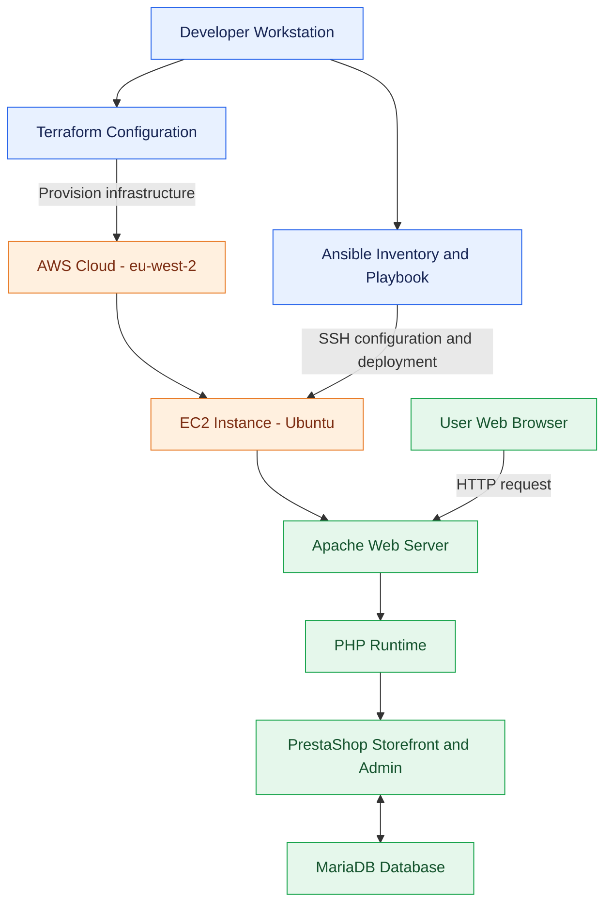

# PrestaShop Deployment Using Terraform and Ansible

## 1. Project Overview
This project automates the deployment of PrestaShop on an AWS EC2 instance using Terraform and Ansible.

## 2. Technologies
- AWS EC2
- Terraform
- Ansible
- Ubuntu
- Apache
- MariaDB
- PHP
- PrestaShop


## 3. Architecture

Terraform provisions the AWS EC2 instance and configures SSH access. Ansible connects to the instance over SSH and automatically installs and configures Apache, PHP, MariaDB, and PrestaShop.



**Deployment flow:**
1. Terraform creates the AWS infrastructure.
2. Ansible connects to the EC2 instance through SSH.
3. The playbook installs and configures the web server, PHP, database, and PrestaShop.
4. Users access the application through the EC2 public IP address.


## 4. Project Structure
- `terraform/` — AWS infrastructure configuration.
- `ansible/` — Ansible inventory and deployment playbook.
- `screenshots/` — Evidence of the deployment and working application.

## 5. Deployment Steps

### Step 1: Provision AWS Infrastructure
```bash
cd terraform
terraform init
terraform fmt
terraform validate
terraform plan
terraform apply
```

### Step 2: Configure Ansible Inventory
Update `ansible/inventory.ini` with the EC2 public IP address and the correct SSH private-key path.

### Step 3: Verify SSH Connectivity
```bash
cd ../ansible
ansible -i inventory.ini prestashop -m ping
```

### Step 4: Deploy PrestaShop
```bash
ansible-playbook -i inventory.ini playbook.yml
```

### Step 5: Verify the Application
Open the EC2 public IP address in a browser and confirm that the PrestaShop storefront and administration page are accessible.

## 6. Infrastructure Verification
Terraform outputs provide the EC2 instance ID, public IPv4 address, and public DNS name.

Ansible automates application installation, database configuration, Apache virtual-host setup, and removal of the PrestaShop installation directory after setup.

## 7. Cleanup
After submission and once screenshots are saved, destroy the Terraform-managed infrastructure to avoid ongoing AWS charges.

```bash
cd terraform
terraform destroy
```

Review the proposed changes and type `yes` to confirm.

## 8. Screenshots
Add screenshots of the working PrestaShop storefront, administration page, and successful infrastructure or Ansible deployment to the `screenshots/` directory.
